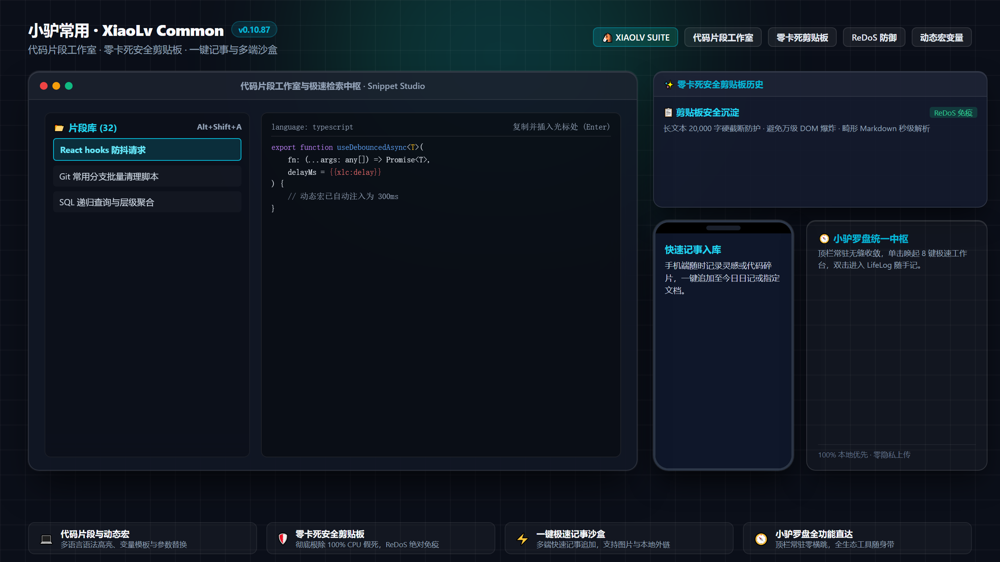

# 小驴常用 · Lv Common

**思源笔记的高频内容资产层与跨平台极速调用中枢**

将零散的代码片段、客服话术、Prompt 提示词、常用表格、文本模板沉淀为有元数据、有来源追溯、可参数化动态求值的思源笔记原生块资产

**当前版本：v0.10.89** ｜ [English Documentation](README.en-US.md) ｜ [更新日志](CHANGELOG.md)

[⬇️ 安装方式](#-安装与升级方式) · [🚀 快速上手](#-3-步极速上手指南) · [🖥️ 面板指南](#-工作台与各面板用途指南) · [⚙️ 设置参考](#-设置项说明) · [⌨️ 快捷键](#-常用快捷键速查) · [🔒 数据与隐私](#-数据与隐私)

 

---

## 🚀 本次更新要点（v0.10.89 · 累积迭代汇总）

- **剪贴板专属快调面板与三栏大视窗**：桌面端新增常驻剪贴板专属栏与历史记录直取，一键「⤓ 插入当前 / ⭐ 存常用 / 🧼 清洗 / 📋 复制」，支持折叠为 36px 窄条并跨会话记忆；工作台弹窗升级为 `min(1280px, 95vw) × min(880px, 94vh)` 三栏大视窗；
- **思源外骨骼生态互通**：小驴罗盘新增「思源外骨骼」磁贴与二级动作直达（速记、划笔、搜块、待办），支持本地 HTTP 与自定义协议多级降级；
- **打字链路性能极速优化**：引入 `cachedWatchedIds` 与 `cachedLibDocIds` 惰性集合缓存，正文打字输入期间完全消除按键重复分配与全量库文档遍历，并与外部数据变更自动失效闭环；
- **AI 进度可视追踪与弹性同步重试**：AI 生成过程呈现阶段化思考卡，命中思源瞬态锁时按指数退避自动重试，杜绝数据写入丢失；
- **设置中心设计系统对齐**：按照 `$ui-checker` 47 项规范优化设置中心，导航侧栏胶囊触控热区扩展至 44px 标准尺寸，表单输入高度统一对齐；
- **日记防冲突归宿与多级探测接入**：全生态公共日记探针全面兼容思源自定义日记路径与双重冲突过滤，追加写入单例互斥锁守护。

展开查看历史版本更新记录（v0.10.86 及更早版本 · 完整记录见 CHANGELOG.md）

- **v0.10.86**：全生态基础设施升级与交互打磨（罗盘启动防抖对齐、LifeLog 照片流与原子多块撤销、全生态联合灾备恢复、移动端全面去电脑化）。
- **v0.10.85**：思源 3.8.10+ 原生文档树菜单、半角斜杠标题防截断保护、片段 Dock 搜索 IME 守卫。
- **v0.10.84**：顶栏罗盘微任务防抖、二级抽屉鼠标锁定与组织迁移。

---

## 🐴 小驴思源全家桶生态矩阵与交流

本插件为「小驴思源生态」8 大官方集市插件之一。所有插件共享小驴罗盘（顶栏常驻中枢）、全域穿透搜索与统一备份恢复：

| 插件名称 | 核心用途 | 官方集市 / 仓库 |
| :--- | :--- | :--- |
| **小驴打卡** | 本地优先习惯打卡、日程提醒与多维人生热力图工作台 | [`siyuan-checkin`](https://github.com/xiaolv-suite/siyuan-checkin) |
| **小驴管家** | 家庭成员中心视角档案、证照保单到期预警与 LifeLog 流水协同 | [`siyuan-home`](https://github.com/xiaolv-suite/siyuan-home) |
| **小驴人脉** | 一人一文档人际管理、圈层力导向关系网络与会前破冰速览 | [`siyuan-contacts`](https://github.com/xiaolv-suite/siyuan-contacts) |
| **小驴拾遗** | 剪藏文章深度消化、视线同焦伴生导读与 4 大学术著录 | [`siyuan-glean`](https://github.com/xiaolv-suite/siyuan-glean) |
| **小驴闪卡** | 原生 FSRS 算法调度、文档内质感序号流与全场景极速制卡 | [`siyuan-lv-cards`](https://github.com/xiaolv-suite/siyuan-lv-cards) |
| **小驴考试** | 全真模拟考场环境、错题靶向归因复训与苏格拉底启发式 AI 导师 | [`siyuan-exam`](https://github.com/xiaolv-suite/siyuan-exam) |
| **小驴常用** | 代码片段工作室、零卡死安全剪贴板历史与一键记事沙盒 | [`xiaolv-common`](https://github.com/xiaolv-suite/xiaolv-common) |
| **小驴雷切** | 毫秒级多文档穿透切换、左右双文档实时分栏对照与切片代码画板 | [`siyuan-speed-switch`](https://github.com/xiaolv-suite/siyuan-speed-switch) |

💬 **官方交流与需求反馈 QQ 群**：**871707735**（开发者实时在线，欢迎反馈问题、交流使用体验与提交新功能构想）。

---

## 🎯 为什么需要小驴常用？它解决什么问题？

在日常使用电脑、写作、编码、沟通时，我们每天都在重复输入大量相同或相似的内容：公司的开票资料、固定的客户答复话术、精调好的 AI 提示词（Prompt）、一段经常调用的 SQL 或脚手架代码。

| 痛点场景 | 传统外部剪贴板 / 常用语软件 | 小驴常用解决方案 |
| :--- | :--- | :--- |
| **数据孤岛与笔记脱节** | 外部工具存的数据脱离知识库，无法与思源笔记双向关联，一处修改到处过时 | **以思源真实块为唯一真源**：每条常用语都锚定在真实思源块上，拥有完整属性与双链回溯能力，数据 100% 本地自主 |
| **死模板无法适应动态上下文** | 复制出来的话术或模板，常需手动改姓名、日期、金额，人工改字极易改错漏改 | **动态变量卡片与 35+ 宏求值引擎**：模板内嵌可变槽位 `{{xlc:ask:客户名}}`、日期计算、大写金额、安全脱敏，调用前秒级填参生成 |
| **高价值笔记片段调取繁琐** | 写在某篇笔记里的优质金句、核心配置，想用时往往要翻箱倒柜搜索，打断心流 | **毫秒级拼音缩写检索与穿透收录**：拼音首字母秒搜，别名 Tab 直达；零 SQL 穿透检索全库笔记，一键将任意块收录为常用资产 |
| **跨软件与跨场景输入摩擦** | 在微信、Word、浏览器、IDE 中想调用笔记内容时，频繁来回切屏 | **全域调用与多形态插入**：支持直接插入编辑器、复制纯文本/富文本到剪贴板，支持作为双链块引用或实时同步嵌入块插入 |

---

## 🌟 核心功能全景

### 1. 思源原生内容资产层（Zero-SQL 安全真源）
- **条目即思源原生块**：条目本体就是你笔记库里的真实块，元数据通过 `custom-xlc-*` 属性存储，超级块（Superblock）承载多段图文与代码围栏，随工作空间自由同步与备份。
- **7 种全形态支持**：纯文本 (Text)、Markdown、代码块 (Code)、网址 (URL)、图片 (Image)、资源文件 (Asset)、块引用 (Blockref) 与超级块结构 (Structure)。
- **富文本原生预览与 Callout 提示**：内置零安全隐患的富文本渲染器，原生支持代码高亮着色、Markdown 任务清单交互样式、表格多列对齐与 Callout 告警卡片化预览（💡 NOTE、🚀 TIP、⚠️ WARNING 等）。
- **智能热度混合排序 (Frecency)**：结合使用频次与时间衰减阶梯（24小时/7天/30天/90天），高频常用条目自适应置顶。

### 2. 交互式参数填充卡与选区包裹
- **交互填参表单**：支持 `{{xlc:ask:客户名}}`（单行输入）、`{{xlc:ask:方案|标准版,旗舰版}}`（下拉单选）、`{{xlc:ask:需求|UI,开发,测试|multi}}`（多选胶囊）、`{{xlc:ask:日期|date}}`（日期拾取器）与多行文本输入。
- **光标选区包裹模式**：在思源编辑器中划选一段文字，按 `⌥⇧W` 即可一键将选区文本包裹进 Prompt 模板或代码围栏中。
- **参数记忆与预设保存**：自动本地记忆最近输入值（LRU 200 项），支持「💾 存为预设方案」，多套业务参数一键秒切。

### 3. 35+ 动态宏计算与数据求值引擎
在模板中嵌入 `{{xlc:...}}`，调用时自动计算求值：
- **时间与日期**：`{{xlc:date}}`、`{{xlc:time}}`、`{{xlc:datetime}}`、`{{xlc:weekday}}`、`{{xlc:lunar}}`（农历干支生肖）、`{{xlc:greeting}}`（早中晚自适应问候语）。
- **随机与生成**：`{{xlc:uuid}}`、`{{xlc:nanoid}}`、`{{xlc:password}}`（强密码）、`{{xlc:choose|A,B,C}}`（加权随机抽取）、`{{xlc:seq|1|10}}`（区间数字序列）。
- **财务与算法**：`{{xlc:currency|1234.56}}`（人民币大写金额转换）、`{{xlc:calc|100*1.13}}`（零 eval 纯数学计算）、`{{xlc:thousands|1234567}}`（千分位添加与清洗）。
- **文本脱敏与转换**：`{{xlc:smask|keep|13812345678|3|4}}`（手机号身份证掩码脱敏 `138****5678`）、`{{xlc:case:camel|foo_bar}}`（驼峰/下划线命名互转）、`{{xlc:json|user.name|...}}`（多层 JSON 字段安全提取）。

### 4. 专业排版与工程处理工具箱（70+ 纯函数）
- **Markdown 排版**：表格列宽全自动垂直对齐 (`beautifyMarkdownTable`)、盘古之白中英文智能空格 (`formatPanguSpacing`)、Markdown 标题多级序号自动编排与剥离 (`numberMarkdownHeadings`)、Callout 智能转换。
- **表格与数据转换**：TSV / CSV 与 Markdown 对称表格互转、表格矩阵行列转置（$M^{TT} = M$）、Markdown 表格导出为标准 CSV / JSON / YAML 键值对。
- **列表整理**：有序列表断号自动重排、任务待办清单批量重置与拼音自然排序。

---

## 🖥️ 工作台与各面板用途指南

| 面板 / 视图 | 唤起方式 | 核心定位与业务场景 |
| :--- | :---: | :--- |
| **主搜索工作台 (Main Palette)** | 顶栏图标 / 快捷键 | 核心检索中心：支持拼音首字母模糊匹配、分类标签过滤、条目快速插入/复制与 Space 键大卡片预览。 |
| **极窄迷你模式 (Mini Mode)** | 工作台顶栏切换 | 极简单列浮动面板：仅占屏幕一角，支持 `1`~`9` 数字键一击直达，适合边看参考边高频录入。 |
| **侧栏面板 (Dock View)** | 思源右侧边栏常用图标 | 常驻侧边栏：按分类折叠展示高频条目，支持鼠标拖拽完整条目直接投入当前笔记正文。 |
| **参数填充卡 (Variable Prompt)** | 触发含变量条目时弹出 | 动态表单窗口：自动渲染输入框、下拉框与日期拾取器，带实时求值预览与预设保存。 |
| **快捷工具箱 (Utility Drawer)** | 新建/编辑窗口内工具菜单 | 排版与数据转换抽屉：一键执行盘古之白加空格、表格美化对齐、金额大写转换与 JSON 格式化。 |

---

## 🚀 3 步极速上手指南

### 1. 配置内容库
首次启动插件时，系统会自动弹出引导卡片：
- **新建专用库文档（推荐）**：在现有笔记本中一键创建名为 `小驴常用库` 的专属归档文档；
- **绑定已有文档**：选择已有任意文档作为常用语存放地。

### 2. 录入与资产沉淀
- **快捷键唤起**：按 `Alt+Shift+N` 直接打开新建表单；
- **划选收录**：在思源编辑器中选中任意文本，点击浮动工具栏的小驴图标一键存入；
- **剪贴板一键转正**：在搜索弹窗切到「📋 剪贴板」视图，选中任意复制过的历史片段按 `Alt+S` 一秒入库；
- **全域穿透收录**：在搜索工作台直接搜索思源全库笔记，按 `Alt+S` 即可将普通笔记块收录为常用资产。

### 3. 秒级检索与调用
- **呼出主面板**：按顶部工具栏图标，或使用快捷键呼出常用语工作台；
- **快速拼音搜索**：直接敲拼音首字母（如输入 `cwbx` 秒搜 `财务报销`）；
- **执行调用**：
  - `Enter`：将内容直接插入当前思源编辑器光标处；
  - `Ctrl + Enter`（Mac: `⌘ + Enter`）：复制纯文本/富文本到系统剪贴板（供微信/邮件等外部软件粘贴）；
  - `Shift + Enter`：作为实时同步嵌入块插入（源块变动，插入处自动同步更新）；
  - `Alt + Enter`：作为双链块引用插入（`((id '锚文本'))`）；
  - `Alt + 1 ~ 9`：快速插入对应序号条目；`Alt + Shift + 1 ~ 9`：快速复制对应序号条目；
  - `空格键`：唤起 Quick Look 沉浸式居中大卡片预览。

---

## 📦 安装与升级方式

> 宿主要求：**思源笔记 v3.8.4 及以上**（桌面端与手机端全支持）。

1. **思源集市安装（推荐）**：在思源笔记中打开 `设置 → 集市 → 插件`，搜索 **「小驴常用」**（或 `xiaolv-common`）点击下载并启用。
2. **离线包手动安装 / 回滚升级**：
   - 获取项目根目录产出的 `package.zip`（或回滚包 `package-v0.10.78.zip`）；
   - 解压到思源工作空间 `<workspace>/data/plugins/xiaolv-common/` 目录（确保 `plugin.json`、`index.js`、`index.css` 位于该目录根层）；
   - 在思源笔记 `设置 → 插件` 中开启「小驴常用（内测版）」。

---

## ⚙️ 设置项说明

思源顶部菜单「设置」→「插件设置」→「小驴常用」中配置，核心配置项实时生效：

| 分组 | 设置项名称 | 配置键 | 默认值 | 推荐与影响说明 |
| :--- | :--- | :--- | :---: | :--- |
| **库与存储** | 常用库文档 ID | `libraryDocId` | `自动生成` | 绑定存放常用条目超级块的思源文档，可在引导向导中随时重设 |
| **检索偏好** | 默认检索范围 | `defaultScope` | `all` | `all`（全部常用库）、`current-doc`（当前文档）或 `clipboard`（剪贴板历史） |
| **剪贴板** | 剪贴板历史采集 | `clipboardHistoryEnabled` | `true` | 开启后自动在内存中暂存近期复制历史，支持一键沉淀为常用语 |
| **剪贴板** | 剪贴板容量上限 | `clipboardCapacity` | `30` | 内存中保留的最大复制历史条数（可选 30 / 50 / 100 档位） |
| **界面交互** | 默认展示形态 | `viewMode` | `palette` | `palette`（标准大弹窗）或 `mini`（极窄单列迷你模式） |
| **快捷调用** | 别名唯一匹配 Tab 直达 | `tabExactAlias` | `true` | 输入词与某条目别名完全一致且唯一时，按 `Tab` 键秒级插入 |
| **排版习惯** | 插入时自动盘古空格 | `panguSpacingOnInsert` | `false` | 插入正文时自动在中英文与数字之间补齐标准排版空格 |

---

## ⌨️ 常用快捷键速查

| 功能操作 | Windows / Linux 默认 | macOS 默认 | 适用位置 |
| :--- | :--- | :--- | :--- |
| **唤起主工作台 / 搜索面板** | `Alt + Shift + A`（或自定义） | `⌥ + ⇧ + A` | 思源全局任意位置 |
| **全局迷你条** | `Alt + Shift + M` | `⌥ + ⇧ + M` | 系统全局（后台最小化可用） |
| **保存选区为条目** | `Alt + Shift + E` | `⌥ + ⇧ + E` | 思源编辑器划选文本时 |
| **快速捕获剪贴板** | `Alt + Shift + V` | `⌥ + ⇧ + V` | 思源全局任意位置 |
| **新建条目** | `Alt + Shift + N` | `⌥ + ⇧ + N` | 思源全局任意位置 |
| **选区包裹进模板** | `Alt + Shift + W` | `⌥ + ⇧ + W` | 思源编辑器划选文本时 |
| **粘贴队列下一条** | `Alt + Shift + Q` | `⌥ + ⇧ + Q` | 思源全局任意位置 |
| **剪贴板历史** | `Alt + Shift + H` | `⌥ + ⇧ + H` | 思源全局任意位置 |
| **切换侧栏 Dock** | `Alt + Shift + D` | `⌥ + ⇧ + D` | 桌面端 |
| **聚焦搜索输入框** | `/` 或 `Ctrl + F` | `/` 或 `⌘ + F` | 常用面板打开时 |
| **直接插入编辑器** | `Enter` | `Return` | 搜索面板列表中选中条目时 |
| **复制到剪贴板** | `Ctrl + Enter` | `⌘ + Return` | 搜索面板列表中选中条目时 |
| **作为嵌入块插入** | `Shift + Enter` | `⇧ + Return` | 搜索面板列表中选中条目时 |
| **作为块引用插入** | `Alt + Enter` | `⌥ + Return` | 搜索面板列表中选中条目时 |
| **沉浸大卡片预览** | `Space`（空格键） | `Space` | 列表中选中条目（非输入态） |
| **退出 / 关闭** | `Esc` | `Esc` | 全局浮层 |

---

## 🔒 数据与隐私

- **100% 本地优先**：全部条目与配置保存在您的思源工作空间与 `data/storage/petal/xiaolv-common/` 目录中，**绝不上云、零遥测、零埋点、零第三方统计 SDK**；唯一的例外是您主动配置并触发 AI 展开时，才会把对应条目文本发送给您自己配置的 AI 服务。
- **随时可搬走**：条目本体是思源原生块，随工作空间自由同步与备份；侧车配置可随插件数据整体导出迁移。

---

## 🔒 设计安全与已知限制说明

- **条目容器（超级块）**：每个条目是库文档里的一个顶层块，多段正文装进一个超级块，条目元数据只写在这个块的 `custom-xlc-*` 属性上。已在隔离思源内核 `v3.8.9` + 真实思源桌面前端完成写入、读回、更新、删除、5 个示例包逐条回读与 [24 步真实宿主回归清单](scripts/e2e-real-checklist.cjs)（25/25 全部通过）。
- **零 SQL 核心依赖红线**：严禁调用 `/api/query/sql`，所有块级操作严格使用官方结构化数据 API。
- **移动端边界**：Android 真实设备触控与图片直接写系统剪贴板受限于移动端宿主沙箱，已做好优雅降级提示。

---

## ❓ 常见问题 (FAQ)

- **Q1：常用语数据存放在哪里？会污染我平时的笔记本吗？**  
  **答：** 条目正文作为标准思源块保存在你指定的专用库文档（如《小驴常用库》）中，绝不随地散落。所有元数据通过 `custom-xlc-*` 块属性存储，既能享受思源原生的双链与版本历史，又完全受控于单个文档之内。
- **Q2：能否支持多段落的复杂模板、列表和代码？**  
  **答：完全支持！** 从 v0.10.80 起，多段内容会自动装入一个思源超级块（Superblock），段落、有序列表、代码块均能原样保留高亮与格式，插入时分毫不差。
- **Q3：手机端能正常使用吗？**  
  **答：** 支持移动端检索与一键复制，已针对触控、安全区和软键盘做适配；但 Android 真机与图片位图写剪贴板仍未完成验收（见 `BLOCKERS.md` B-002/B-003），手机端不提供桌面侧栏与全局热键能力。未验证项在界面内按「待验证」降级呈现。

---

## 📄 许可证 (License)

[MIT License](LICENSE) · Copyright (c) 2026 xiaolv-suite

[MIT License](LICENSE) · Copyright (c) 2026 xiaolv-suite
