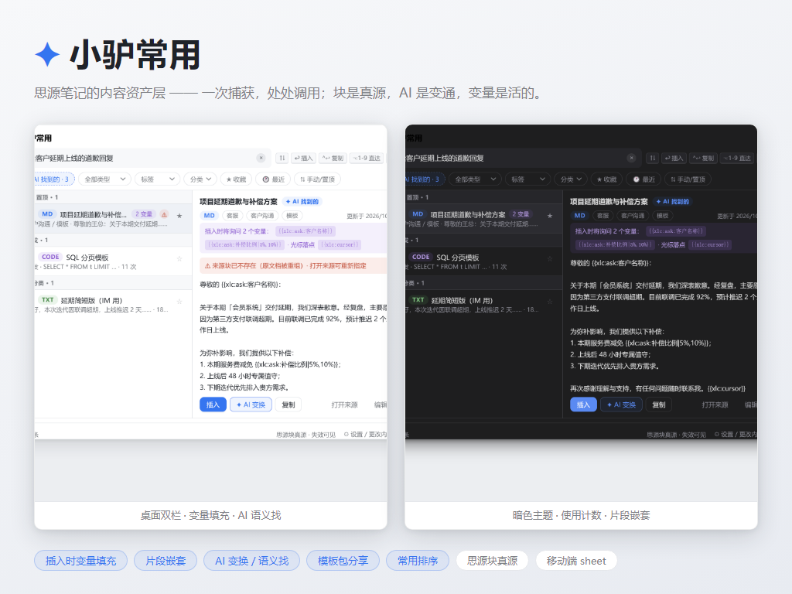

# 小驴常用 (Lv Common)

> **思源笔记的高频内容资产层与跨平台极速调用中枢** 
> 将零散的代码片段、客服话术、Prompt 提示词、常用表格、文本模板沉淀为有元数据、有来源追溯、可参数化动态求值的思源笔记原生块资产。

---

## 💡 为什么需要小驴常用？

在日常使用电脑、写作、编码、沟通时，我们每天都在重复输入大量相同或相似的内容：公司的开票资料、固定的客户答复话术、精调好的 AI 提示词（Prompt）、一段经常调用的 SQL 或脚手架代码。

传统的解决方案往往有明显痛点：
- **痛点 1：传统外部剪贴板/常用语工具脱离知识库**
  外部工具存的数据是孤岛，无法双向关联到笔记，无法利用思源强大的双链体系；一旦修改，到处都是陈旧版本。
- **痛点 2：静态内容无法适应动态上下文**
  复制出来的话术或模板，常常需要手动修改“客户姓名”、“当前日期”、“订单金额”、“指定选项”，人工改字极其容易漏改、改错。
- **痛点 3：全库笔记中沉淀的高价值片段难以秒级调取**
  写在某篇笔记里的优质金句、核心配置或任务清单，想用的时候往往需要翻箱倒柜搜索，打断心流。

**小驴常用的解决方案**：
- **以思源真实块为唯一真源**：每条常用语都锚定在真实思源块上，拥有完整属性与双链回溯能力，来源块失效或移动状态一目了然。
- **动态变量填参与宏求值引擎**：模板内嵌可变槽位、自然语言日期算术、随机选项、大写金额、安全脱敏，调用前秒级填参生成，告别死模板。
- **毫秒级拼音搜索与全域内容终端**：拼音首字母缩写秒搜，别名 Tab 闪电直达；支持零 SQL 穿透检索全库笔记，一键收录为常用资产。
- **跨平台全局可用**：提供成熟的窗口桥、协议命令与 Quicker / Raycast / AutoHotkey 联动脚本，在微信、Word、浏览器、IDE 中任意上屏。

---

## 🎯 五大典型使用场景

| 场景 | 典型内容 | 小驴常用赋能特性 |
| :--- | :--- | :--- |
| **👩‍💼 客服支持与运营沟通** | 售后指引、退换货条款、问候致谢、物流查询说明 | 动态变量卡片 `{{xlc:ask:客户名}}` 填参、语境自适应问候宏 `{{xlc:greeting}}`、手机号/邮箱敏感信息掩码脱敏 `{{xlc:mask}}`、一键复制纯文本 |
| **🤖 AI 提示词 (Prompt) 库** | 结构化 CoT 思维链、角色设定、论文润色、代码 Review 指令 | 选区包裹模式（`⌥⇧W` 划选文本一键包裹进 Prompt 模板）、片段嵌套组合 `{{xlc:snippet:角色设定}}`、多预设方案保存 |
| **💻 研发与技术常用件** | 高频 SQL 模板、Docker/K8s 指令、正则规则、脚手架配置 | 代码语言围栏保留、JSON/Properties 互转、Base64 与 URL 编解码、文本哈希指纹、前置缩进 Tab/空格转换 |
| **📑 商务、采购与财务发票** | 公司开票资质、公户账号、报价单模板、差旅报销说明 | 中文人民币金额大写转换宏 `{{xlc:currency}}`、多行费用数值一键求和汇总 (`sumNumericLines`)、TSV 表格一键转标准 Markdown 表格 |
| **✍️ 知识沉淀与日常写作** | 论文引文标准 (CSL/APA)、会议纪要模板、任务 SOP 清单 | 盘古之白排版加空格 (`formatPanguSpacing`)、Markdown 待办任务清单批量重置、多行自动编号、长文精要摘要提炼 |

---

## 📦 安装与升级方式

> 宿主要求：**思源笔记 v3.8.4 及以上**（桌面端与手机端全支持）。

1. **思源集市安装（推荐）**：在思源笔记中打开 `设置 → 集市 → 插件`，搜索 **「小驴常用」** 点击下载并启用。
2. **离线包手动安装 / 回滚升级**：
   - 获取项目根目录产出的 `package.zip`（或回滚包 `package-v0.10.78.zip`）；
   - 解压到思源工作空间 `<workspace>/data/plugins/xiaolv-common/` 目录（确保 `plugin.json`、`index.js`、`index.css` 位于该目录根层）；
   - 在思源笔记 `设置 → 插件` 中开启「小驴常用（内测版）」。

---

## 🚀 3 步极速上手指南

### 1. 配置内容库
首次启动插件时，系统会自动弹出引导卡片：
- **新建专用库文档（推荐）**：在现有笔记本中一键创建名为 `小驴常用库` 的专属归档文档；
- **新建独立笔记本**：为常用内容单独创建一个隔离笔记本；
- **绑定已有文档**：选择已有任意文档作为常用语存放地。

### 2. 录入与资产沉淀
- **快捷键唤起**：按 `⌥⇧N`（或 `Alt+Shift+N`）直接打开新建表单；
- **划选收录**：在思源编辑器中选中任意文本，点击浮动工具栏的小驴图标一键存入；
- **剪贴板一键资产化**：在搜索弹窗切到 `📋 剪贴板` 视图，选中任意复制过的历史片段按 `Alt+S` 一秒入库；
- **全域穿透收录**：在搜索工作台直接搜索思源全库笔记，按 `Alt+S` 即可将普通笔记块收录为常用资产。

### 3. 秒级检索与调用
- **呼出主面板**：按顶部工具栏图标，或使用快捷键呼出常用语工作台；
- **快速拼音搜索**：直接敲拼音首字母（如输入 `cwbx` 秒搜 `财务报销`）；
- **执行调用**：
  - `Enter`：将内容直接插入当前思源编辑器光标处；
  - `Ctrl + Enter`（Mac: `⌘ + Enter`）：复制纯文本/富文本到系统剪贴板（供微信/邮件等外部软件粘贴）；
  - `Shift + Enter`：作为实时同步嵌入块插入（源块变动，插入处自动同步更新）；
  - `Alt + Enter`：作为双链块引用插入（`((id '锚文本'))`）；
  - `Alt + 1 ~ 9`：快速插入对应序号条目；`Alt + Shift + 1 ~ 9`：快速复制对应序号条目；
  - `空格键`：唤起 Quick Look 沉浸式居中大卡片预览。

---

## 🛠️ 核心功能与作用全景

### 一、思源原生内容资产层（安全真源）
- **思源块真源原则（Zero-SQL）**：条目即真实思源块，正文严格由思源块管理，元数据走 `custom-xlc-*` 属性，侧车（`loadData`）仅管理本地收藏/排序/UI 偏好，随时可重建迁移。
- **7 种丰富条目形态**：原生识别并支持纯文本 (Text)、Markdown、代码块 (Code，保留语法高亮)、网址 (URL)、图片 (Image)、附件资源 (Asset)、块引用 (Blockref) 与超级块结构 (Structure)。
- **富文本与结构化原生预览**：内置零安全隐患的富文本渲染器，原生支持代码高亮着色、Markdown 任务清单交互样式、表格多列对齐与 Callout 告警卡片化预览（💡 NOTE、🚀 TIP、⚠️ WARNING、🛑 DANGER 等）。
- **场景分类与层次化标签**：预置商务天蓝、客服翡翠绿、开发淡紫、写作暖琥珀、AI 亮靛语义徽标；支持 `/` 斜杠路径多层级标签与级联筛选。
- **智能热度混合排序 (Frecency)**：结合使用频次与时间衰减阶梯（24小时/7天/30天/90天），高频常用条目自适应置顶。
- **别名唯一匹配 Tab 直达**：输入词与条目别名完全吻合且全局唯一时，行内呈现金色 ⚡ 徽标，按 Tab 闪电插入，心流毫无停顿。
- **Space 沉浸大卡片预览**：非输入态按空格键即可弹出居中 720px 沉浸式 Quick Look 大卡片，阅读长文与代码无需受右侧窄栏限制。

### 二、交互式填参表单与选区包裹
- **交互填参卡片**：`{{xlc:ask:客户名}}`（单行输入）、`{{xlc:ask:方案|标准版,旗舰版}}`（下拉单选）、`{{xlc:ask:需求|UI,开发,测试|multi}}`（多选胶囊）、`{{xlc:ask:日期|date}}`（日期拾取器）、`{{xlc:ask:备注|textarea}}`（多行文本输入）。
- **光标选区包裹模式**：支持 `{{xlc:selection}}` 与 `{{xlc:selection|默认内容}}`，在思源编辑器中划选文本即可一键包裹进 Prompt 模板、引用块或代码围栏。
- **变量历史记忆与预设**：自动本地记忆变量最近输入值（LRU 200 项），支持「💾 存为预设方案」与多套方案自由切换。
- **实时展开动态预览**：填写卡底部实时防抖求值并展示展开后预览效果，所见即所得。

### 三、强大动态宏计算引擎（35+ 动态宏体系）
在模板中嵌入 `{{xlc:...}}` 语法，插入或复制时自动完成动态求值与替换：
- **时间与日期**：`{{xlc:date}}`、`{{xlc:time}}`、`{{xlc:datetime}}`、`{{xlc:weekday}}`、`{{xlc:year}}`、`{{xlc:quarter}}`、`{{xlc:month}}`、`{{xlc:day}}`、`{{xlc:timeago}}`（自然语言相对时间，如“刚刚”、“3分钟前”）、`{{xlc:lunar}}`（农历干支生肖年份）、`{{xlc:cron}}`（Cron 表达式自然语言解析）、`{{xlc:greeting}}`（早中晚自适应问候语）。
- **随机生成与采样**：`{{xlc:uuid}}`（标准 UUIDv4）、`{{xlc:id}}`（短 ID）、`{{xlc:nanoid}}`（紧凑安全 NanoID）、`{{xlc:password}}`（高安全密码生成）、`{{xlc:random}}`（等概率随机选择）、`{{xlc:choose}}`（加权概率抽取）、`{{xlc:seq}}`（区间数字序列生成，支持步长、前导零补齐与换行分列）、`{{xlc:randomcolor}}`（随机 HEX/RGB/HSL 色值）、`{{xlc:randomname}}`（拟真中英文随机姓名）。
- **数值、算法与逻辑**：
  - `{{xlc:if|10 > 5|大|小}}` / `{{xlc:if|role == 'admin'|管理员|用户}}`：安全递归无 eval 三元条件判断；
  - `{{xlc:calc|100*1.13}}`：递归下降零 eval 纯数学计算器；
  - `{{xlc:stats|10,20,30,40}}`：均值、中位数、方差与总和快速计算；
  - `{{xlc:thousands|1234567.89}}`：数值千分位逗号添加与清洗；
  - `{{xlc:checksum|hello}}`：CRC32 与 Adler32 十六进制轻量校验和短码；
  - `{{xlc:currency|1234.56}}`：中文人民币大写金额转换；
  - `{{xlc:plural|item|2}}`：英文单词单复数规则与不规则智能转换。
- **文本转换与脱敏保护**：
  - `{{xlc:case:camel|text}}`：全大写、全小写、小驼峰、大驼峰、蛇形等 8 种代码命名规范转换；
  - `{{xlc:radix:16:10|0xFF}}`：二进制/八进制/十进制/十六进制跨进制互转；
  - `{{xlc:smask|keep|13812345678|3|4}}`：任意字符串留头留尾区间脱敏（`138****5678`）；
  - `{{xlc:censor|文本|敏感词|***}}`：敏感词屏蔽与等长星号遮罩；
  - `{{xlc:json|user.name|JSON}}` / `{{xlc:json:keys|JSON}}` / `{{xlc:json:pretty|JSON}}`：安全提取多层属性与数组下标（支持单双引号方括号语法，如 `users[0]["name"]`、`settings["api.key"]`），严密防御原型链穿透，支持格式化与键名提取；
  - `{{xlc:progress|7|10}}` / `{{xlc:progress:circle|3|5}}` / `{{xlc:progress|75}}`：生成方块/圆点/ASCII 多种视觉形态的任务进度条；
  - `{{xlc:shuffle|A,B,C}}`：列表候选项 Fisher-Yates 伪随机均匀打乱；
  - `{{xlc:btruncate|10|你好世界}}`：UTF-8 字节安全边界截断，彻底避免汉字多字节被劈开导致乱码；
  - `{{xlc:initials|思源笔记}}`：中文汉字拼音首字母与英文首字母缩写提取（`SYBJ`）；
  - `{{xlc:repeat|=|20}}`：字符/短语指定次数重复生成；
  - `{{xlc:center|20|标题}}`：中英视觉字宽对称居中对齐填充；
  - `{{xlc:revwords|the quick brown fox}}`：单词级别逆序反转；
  - `{{xlc:escape|a|b|c}}`：宏嵌套管道符 `\|` 转义保护；
  - `{{xlc:slash|C:\Users}}`：反斜杠转义保护；
  - `{{xlc:template|你好 {name}|name=张三}}`：迷你模板变量插值渲染；
  - `{{xlc:snippet:公共头}}`：片段嵌套引用调用（支持环路熔断保护）。

### 四、纯文本与排版工程处理工具箱（70+ 纯函数，动作菜单与表单快捷栏一键执行）
- **Markdown 专业排版与结构化**：
  - Markdown 表格列宽美化与对齐（`beautifyMarkdownTable`，计算 CJK 双倍字宽最大列宽，智能填充空格使整张表格在源码视图完全垂直对齐，自动补齐不对称列）；
  - Markdown 表格矩阵行列转置（`transposeMarkdownTable`，行与列互换，$M^{TT} = M$ 可逆转置）；
  - Markdown Callout 告警提示块智能包装与转换（`formatMarkdownCallout`，支持包装为 GitHub/Obsidian 规范的 `> [!NOTE]` 等 Callout 警告块及折叠语法，支持一键纯净剥离）；
  - Markdown 标题十进制层级序号自动编排与剥离（`numberMarkdownHeadings`，自动编排 `1.`、`1.1`、`1.1.1` 序号或安全剥离）；
  - 盘古之白中英文智能空格排版（`formatPanguSpacing`）；
  - 中英混排标点间距与全半角空白规范化（`formatPunctuationSpacing`）；
  - 全流程综合排版规整（`formatCJKSpacingComprehensive`）；
  - 水平分割线标准化与防 Setext 二级标题误解析保护（`normalizeHorizontalRules`）；
  - 引用块层级升降（`shiftMarkdownBlockquotes`）与引用块扁平化剥离（`flattenMarkdownBlockquotes`）；
  - 代码围栏语言高亮批量补全（`setMarkdownCodeFenceLang`）；
  - 各级标题与缩进列表双向智能互转（`convertHeadingsToList`）；
  - 多级标题大纲目录 TOC 提取与锚点 Slug 生成（`generateMarkdownToc`）；
  - 脚注编号自动重排与底端归集（`normalizeMarkdownFootnotes`）；
  - 超链接批量提取与形态转换（`convertMarkdownLinks`）；
  - 行内粗体、斜体、删除线、代码标记批量剥离（`stripInlineMarkdownFormatting`）。
- **表格数据全能转换**：
  - TSV / CSV 转 Markdown 对称表格；
  - Markdown 表格列对齐方式批量设置（居中、靠右、靠左，`alignMarkdownTableColumns`）；
  - Markdown 表格按指定列排序（`sortLinesByColumn`）与条件筛选（`filterMarkdownTable`）；
  - Markdown 表格导出为标准 RFC 4180 CSV / TSV（`markdownTableToDelimited`）；
  - Markdown 表格导出为 YAML / Properties / JSON 键值对（`markdownTableToKeyValue`）；
  - 键值对 / YAML / JSON 对象快速生成 Markdown 表格（`keyValueToMarkdownTable`）；
  - 多行关键数据自动生成 KPI 核心指标汇总看板卡片（`formatKpiSummaryCard`）。
- **列表与待办深度重整**：
  - 有序与无序列表双向批量互转（`convertListStyle`）；
  - 有序列表断裂序号重新按序连续自增编号（`renumberOrderedList`）；
  - 列表项按拼音/字母自然排序（`sortMarkdownList`）；
  - 多层嵌套列表展开打平或祖先路径展开（`flattenNestedList`）；
  - 列表层级缩进批量升降（`shiftListIndentation`，增加或减少 2 空格）；
  - 列表分隔符智能嗅探与逗号/换行批量互转（`convertListDelimiter`）；
  - Markdown 任务列表进度条与统计（`calculateTaskProgress`）；
  - 待办任务状态智能反转（`invertTaskStatus`）与任务状态筛选提取（`filterTaskItems`）。
- **代码与文本深度清洗**：
  - 代码注释批量安全剥离（状态机追踪单双引号与反引号，保护字符串字面量中的 `//` 和 `#`）；
  - 代码语言智能嗅探（高置信度识别 10+ 门主流语言特征并自动包裹代码块）；
  - 多行日志/任务按前缀标记自动分组聚合（`groupLinesByPattern`）；
  - 变量命名法智能互转（camelCase、snake_case、PascalCase、kebab-case）；
  - Markdown 纯代码块提取并剥离文字解释（`extractCodeBlocksFromMarkdown`）；
  - 多行文本基于列宽网格分栏排版（`formatTextColumnsGrid`）；
  - 多行文本按中英视觉宽度升降序排序（`sortLinesByVisualWidth`）；
  - 多行文本按首字拼音/字母分节大纲生成（`groupLinesByAlphabet`）；
  - 行尾多余空白与不可见 NBSP 严格清洗（`sanitizeLineEndingsAndSpaces`）；
  - 连续多余空行严格归一化压缩与首尾边缘修剪（`normalizeBlankLinesStrict`）；
  - 阿拉伯数字 1~20 与圈号序号符号（`①`~`⑳`）、括号序号双向转换（`convertNumberSymbols`）；
  - 多行数值区间范围筛选（`filterNumericRangeLines`）；
  - 多行文本前后缀幂等补齐（`ensureLineAffixes`）与剥离（`stripAffixes`）；
  - 多行文本集合运算（差集、交集、并集，`setOperationsOnLines`）。

### 五、全域搜索、极窄迷你模式与小驴全生态联动
- **全库块穿透检索 (Omni-Search)**：输入 `@`、`/` 或 `sy:` 穿透搜索思源全库块资产，免写 SQL，支持 `in:路径` 限定范围。
- **开箱即用行业套件市场 (Starter Packs Hub)**：主面板底栏常驻「📦 开箱套件」入口，内置商务财务、电商客服、研发运维、写作排版四大行业专属场景套件与 Callout 排版包、渐进复习包；配备抽屉预览、一键装入当前库（已存条目智能去重）以及在思源当前笔记本中一键创建专属结构化大纲文档（如《常用资产 · 商务与财务开票套件》）并由小驴常用自动纳管。
- **极窄单列悬浮迷你模式 (Mini Mode · 快捷键 `Alt+M`)**：单列极窄布局无遮挡，适合与外部窗口侧边分屏作业；内置 1~9 快捷数字角标（按 1~9 插入，Shift+1~9 复制）；顶部拖拽把手支持随心停靠并记忆位置；支持一键折叠为微型边缘胶囊浮标，随手停靠桌面边缘。
- **小驴全生态无缝联动与双向闭环 (Ecosystem Interoperability)**：
  - **外部服务桥 (window.xiaolvCommon) 契约对齐**：`search`、`recent`、`get` 返回条目全面补齐 `content` 正文字段，满足小驴雷切（`siyuan-speed-switch`）全局检索回车复制与快门契约；
  - **全生态动态宏矩阵展开**：内嵌 `{{xlc:home:today}}`（小驴管家备忘）、`{{xlc:task:today}}`（任务视界任务）、`{{xlc:glean:recent}}`（小驴拾遗剪藏）、`{{xlc:contacts:recent}}`（小驴人脉名片）、`{{xlc:checkin:today}}`（小驴打卡清单），超时熔断、全异常隔离、未安装时优雅降级；
  - **全域生态联邦搜索 (Federated Ecosystem Search)**：输入「待办」、「剪藏」、「打卡」或联系人姓名时，自动并行联合检索兄弟插件数据，在提供方分区一键回车插入或复制；
  - **剪贴板一键推送到小驴管家备忘**：剪贴板历史卡片增设 `📋` 动作按钮，临时复制的内容一键转为管家待办备忘；
  - **Epoch 6 统一事件总线标准信封**：所有条目生命周期事件统一采用 `v: 1, source: "xiaolv-common", eventId, at, payload, idempotencyKey` 标准信封广播，兼顾前后向兼容。
- **连续粘贴取用队列 (Paste Queue)**：多选常用条目设为取用队列，按下 `⌥⇧Q` 连续出栈粘贴填入，大幅提高多表单填写效率。
- **外部桌面全局直喷**：开放 `window.xiaolvCommon` 窗口桥与公开思源协议命令，设置面板提供开箱即用的 Quicker 动作配置、Mac Raycast 脚本与 AutoHotkey 脚本。

### 六、资产健康体检与效率收益透视
- **内容库语法与依赖健康体检中心**：一键全库扫描死链、损坏占位符与嵌套死循环，分级输出诊断报告。
- **打字时间节省与工时收益看板**：基于调用频次与字符数，在设置面板实时量化呈现累计击键节省量与工时收益。

---

## ⚙️ 设置项说明

在插件主面板点击底栏 `⚙ 设置`（或在思源插件设置页打开）即可进入分栏设置中心：

| 设置分区 | 关键设置项 | 默认值 | 作用说明 |
| :--- | :--- | :--- | :--- |
| **📦 库配置** | 内容库模式与目标位置 | 未配置（首次启动引导） | 选择「专用库文档（推荐）」、「独立笔记本」或「文档树模式」存放常用语块 |
| **⚙️ 偏好设置** | 插入前询问变量 (`promptVariables`) | 开启 (`true`) | 条目含 `{{xlc:ask:...}}` / `{{input:...}}` 时在插入前弹出填空卡片；关闭则直接用默认值展开 |
| **⚙️ 偏好设置** | 记录使用次数 (`recordUsage`) | 开启 (`true`) | 在本地侧车统计调用频次与最近使用时间，驱动 Frecency 智能排序与效率看板 |
| **⚙️ 偏好设置** | 清空变量填写记忆 | 按需触发 | 一键清除本地侧车记住的历史变量预填值，不影响库内模板块 |
| **🤖 AI 模型** | 启用 AI 助手 / 允许读取完整正文 | 关闭 (`false`) | 复用思源已配置的 AI 模型（插件零密钥）；开启后支持 AI 整理元数据、生成草稿与 `?` 语义检索 |
| **🔍 搜索配置** | 拼音搜索 / 动态占位符替换 | 开启 (`true`) | 支持中文全拼与首字母缩写检索；插入或复制时自动求值 `{{xlc:...}}` 动态宏 |
| **🏥 健康体检** | 条目健康体检中心 | 按需触发 | 扫描全库条目的片段循环嵌套、缺失子片段、损坏占位符与失效链接 |
| **⚡ 外部联动** | 窗口桥与桌面启动器脚本 | 自动就绪 | 一键复制 Quicker、AutoHotkey、Raycast 与 cURL 跨应用调用脚本 |
| **💾 数据与模板** | 导出 / 导入 / 同步冲突比对 | 按需触发 | 支持 JSON 全量备份、Markdown 模板包（含脱敏）、CSV/TSV 批量向导、Espanso 导入及多源 Diff 合并 |

---

## ❓ 常见问题 (FAQ)

- **Q1：我的常用语数据保存在哪里？卸载插件会丢失吗？**
  保存在你指定的**思源笔记真实文档与块**中，标题、别名、简码（`custom-xlc-shortcode`）、标签、分类均作为思源标准块属性（`custom-xlc-*`）随思源同步。即使卸载插件，所有正文和文档依然完整保留在你的笔记本里。
- **Q2：多段落正文、列表、表格能保存吗？**
  可以。从 v0.10.80 起，多段正文会装进**一个超级块**保存在库文档中，新建、编辑、导入和示例包都不再限制为单行；内置 25 条示例全部可安装。唯一限制是正文行首不能出现 `{{{` / `}}}`（超级块边界标记），需要时放进代码围栏即可。早期版本留下的 parts 多块条目仍可读取，正文为只读。
- **Q3：`:shortcode` 简码和普通别名有什么区别？**
  简码（如 `:wk`、`:bug`）支持以冒号前导精确触发，在搜索框输入 `:wk` 时享有最高优先级（+500 加权）置顶，且唯一命中时按 `Tab` 或 `Enter` 直接上屏，同时兼容从 Espanso 配置文件直接导入。
- **Q4：模板里的动态宏怎么确认展开后是什么样？**
  在主工作台或侧边栏选中任意含动态宏的条目时，预览区会自动开启「📝 模板源码 + ⚡ 展开后真实效果」双态实时预览，插入前即可直观核对。

---

## 🔒 数据与隐私

- **100% 本地优先**：全部条目与配置保存在您的思源工作空间与 `data/storage/petal/xiaolv-common/` 目录中，**绝不上云、零遥测、零埋点、零第三方统计 SDK**；唯一的例外是您主动配置并触发 AI 展开时，才会把对应条目文本发送给您自己配置的 AI 服务。
- **随时可搬走**：条目本体是思源原生块，随工作空间自由同步与备份；侧车配置可随插件数据整体导出迁移。

## 🔒 设计安全与已知限制说明

- **条目容器（超级块）**：每个条目是库文档里的一个顶层块，多段正文装进一个超级块，条目元数据只写在这个块的 `custom-xlc-*` 属性上。已在隔离思源内核 `v3.8.9` + 真实思源桌面前端完成写入、读回、更新、删除、5 个示例包逐条回读与 [24 步真实宿主回归清单](scripts/e2e-real-checklist.cjs)（25/25 全部通过）。
- **零 SQL 核心依赖红线**：严禁调用 `/api/query/sql`，所有块级操作严格使用官方结构化数据 API。
- **移动端边界**：Android 真实设备触控与图片直接写系统剪贴板受限于移动端宿主沙箱，已做好优雅降级提示。

---

## 🆕 最新更新动态

### [v0.10.84] — 2026-11-10（GitHub 组织迁移版）

- **顶栏罗盘全面提速与自愈**：8 插件并发启动的顶栏收敛改为微任务防抖批量投影（重绘 8 次 → 1 次）；思源云同步/重启销毁罗盘节点后 100ms 自动重建；
- **桌面端二级抽屉鼠标锁定**与磁贴右键就地聚焦；手机端长按二级菜单防合成 click 误入主界面；
- **输入法与触控四重防线**：软键盘弹起、输入焦点与表单内滚动不再误触面板关闭；
- 全生态按钮即时反馈补齐（记账/打卡视图/复制/分栏/排版微胶囊）；
- 仓库与提交身份迁移至 xiaolv-suite 组织。

### [v0.10.83] — 2026-11-04（最新本地发版）

v0.10.83 本地正式发版：Epoch 7 全生态统一基础设施套件全面落地（原位微动效、瞬时微胶囊、后台主时钟、思源内核写锁、统一浮层焦点栈、AI网关、全家桶灾备总线、小驴罗盘动态徽标与穿透搜索）、并发索引代数锁与写锁内存泄漏根除、多级浮层 Esc 焦点仲裁修复、AI 模板智能展开诚实降级与宿主重试弹性加固：
- **Epoch 7 全生态统一基础设施套件全面落地 (Lv Ecosystem Core Kit)**：
  - **渐进式微动效与降噪通知 (lvNotify)**：复制成功、收藏切换全面接入原位微动效（`lvNotify.inline`）与瞬时微胶囊（`lvNotify.capsule`），彻底收敛突兀弹窗，操作心流零打断；
  - **统一后台主时钟 (lvTicker)**：消灭零散定时器，对齐 10 秒/1 分钟节拍，窗口失焦/最小化时动态开启节电模式降频至 60 秒，减少 75% 唤醒耗电；
  - **思源内核写锁与排队屏障 (withDocLock)**：对同一文档 ID 的异步插入/追加/写入操作进行内存 Promise 串行排队，彻底消除思源底层 `document is locked` 冲突；
  - **统一浮层与键盘焦点栈 (lvSurfaceStack)**：捕获阶段秒级仲裁 `Escape` 键，引入 `"keep"` 保持语义，子模式（多选、QuickLook、菜单）退出不误关底层窗口，严防按键穿透；
  - **统一 AI 并发整形与限流网关 (lvAi)**：支持全局共享 API Key 与模型配置，提供最大并发限流控制与 429 速率限制指数退避重试；
  - **全生态活动主干流 (lvActivity)**：自动广播常用模板应用、代码片段插入等关键操作，支持一键汇编为 Markdown 追加至每日日记（Daily Note）；
  - **全家桶一键联合灾备总线 (lvBackup)**：注册常用资产与偏好灾备切面，支持与全生态兄弟插件一键生成统一联合灾备包及全量恢复；
  - **小驴罗盘联动动态条目徽标 (lvLaunchpad)**：插件入口徽标随常用库条目增删实时响应与动态计算，彻底消除硬编码；
  - **统一穿透全局检索 (lvOmnisearch)**：注册常用语数据源，提供跨插件全文检索，并扩充条目别名（alias）与简码（shortcode）多维度匹配。
- **缺陷修复与全链路工程健壮性 (T-0821 ~ T-0826)**：
  - **核心库服务 · 索引代数锁修复 (T-0821)**：修复 `ensureIndex` 在 `indexGen` 变更后复用旧 `buildingPromise` 的代数竞态缺陷，引入 `buildingGen` 严格绑定构建代数，杜绝跨代陈旧索引覆盖；
  - **基础设施 · withDocLock 内存泄漏修复 (T-0822)**：修正链式 Promise 与当前等待者引用对比逻辑，确保文档写入完成无后续等待者时即刻从 Map 中释放文档 ID；
  - **界面交互 · 浮层焦点栈 Esc 仲裁修复 (T-0823)**：
    - 通知中心卡片改为仅在有活跃 card 时动态入栈，防止空 handle 阻断向下分发；
    - 搜索弹窗退出内部多选或 QuickLook 时返回 `"keep"`，避免整个弹窗过早出栈；
    - 发现工作台（主窗、关闭确认窗、保存视图窗）与常驻侧边栏 Dock 右键菜单全部接入焦点栈，修复 Esc 关闭失效问题；
  - **AI 服务 · 模板智能展开诚实降级 (T-0824)**：为 `aiSmartExpandTemplate` 增加 try/catch 保护，离线或模型未配置时记录日志并安全回退原始正文；
  - **生态协同 · 罗盘条目数动态徽标与穿透搜索增强 (T-0825)**：消除罗盘写死 `"常用 18 项"` 的硬编码，穿透搜索支持别名与简码匹配；
  - **宿主健壮性 · 内核请求重试与时序加固 (T-0826)**：移除 `pushToSourceBlock` 中过早阻断重试的 `maxRetries: 0`；端到端自动化测试引入动态轮询与 `waitForFunction`，消除系统高频 I/O 带来的临界抖动。

### [v0.10.82] — 2026-11-01

v0.10.82 本地正式发版：开箱即用套件市场（Starter Packs Hub）、行业专属场景套件与思源专属大纲文档一键新建、极窄单列悬浮迷你模式（Mini Mode · 1~9数字直达与折叠胶囊）、小驴全生态深层双向联动闭环（雷切复制契约对齐、管家/任务/拾遗/人脉/打卡动态宏矩阵展开、联邦搜索、剪贴板推送到管家备忘与 Epoch 6 标准事件信封）、真实思源宿主 24 步端到端 E2E 自动化门禁覆盖：
- **开箱即用行业套件市场 Starter Packs Hub (T-0808~T-0816 / Batch F12~F14)**：
  - 主面板底栏常驻「📦 开箱套件」入口（`footer.starter-packs`），内置商务财务、电商客服、研发运维、写作排版四大行业专属场景套件及 Callout 排版、渐进复习扩展包；
  - **内容抽屉展开预览**：各套件卡片配备「👁 查看内容」抽屉，无需安装即可实时核阅该套件包含的标题、分类与标签；
  - **一键启用装入常用库**：点击「＋ 一键启用」秒级装入当前库，已存在的条目基于逻辑 ID 自动跳过，绝不重复污染您的库；
  - **思源笔记专属文档深度结合**：点击「📁 新建专属文档」即可在当前思源笔记本中一键创建《常用资产 · 场景套件》结构化大纲文档并自动纳管，正文与属性天然留在思源笔记中。
- **极窄单列悬浮迷你模式 Mini Mode (Batch F11)**：
  - 快捷键 `Alt+M` 或点击搜索栏 `📐` 随时切换极窄单列迷你悬浮模式（`.xlc-dialog--mini`），界面极窄无遮挡，适配侧边吸附分屏作业；
  - **1~9 键直达触发**：单列列表中前 9 项自动挂载微型序号徽标，按 `1` ~ `9` 直接插入、`Shift + 1` ~ `9` 直接复制；
  - **顶部拖拽把手与记忆吸附**：顶部配备拖拽条 `search.mini.drag-bar`，随心拖动并在本地持久化记忆停靠坐标；
  - **一键折叠悬浮胶囊**：点击折叠把手秒级缩为边缘微型胶囊 `search.mini.collapsed-pill`，点击即刻还原，桌面呼之即来挥之即去。
- **小驴生态全域联动与双向闭环 (T-0817~T-0820 / Batch F15)**：
  - **外部服务桥 (window.xiaolvCommon) 契约对齐雷切**：修复 `search`、`recent`、`get` 对外透出接口，为返回的 `CommonSnippet` 统一补充非空可用 `content` 正文字段，满足外部小驴雷切（`siyuan-speed-switch`）全局检索回车复制与快门契约；
  - **全生态动态宏矩阵展开**：内嵌 `{{xlc:home:today}}` / `{{xlc:butler:today}}`（小驴管家备忘）、`{{xlc:task:today}}`（任务视界任务）、`{{xlc:glean:recent}}`（小驴拾遗剪藏）、`{{xlc:contacts:recent}}`（小驴人脉名片）、`{{xlc:checkin:today}}`（小驴打卡清单），超时熔断、全异常隔离、未安装时优雅降级；
  - **全域生态联邦搜索 (Federated Ecosystem Search)**：输入「待办」、「备忘」、「剪藏」、「打卡」或联系人姓名时，自动并行联合检索兄弟插件数据，在提供方分区一键回车插入或复制；
  - **剪贴板一键推送到小驴管家备忘**：剪贴板历史卡片增设 `📋` 动作按钮（`item.promote-to-home`），临时复制的内容一键转为管家待办备忘，按钮即时反馈为「✓ 已推备忘」；
  - **Epoch 6 统一事件总线标准信封**：所有对外广播的条目生命周期事件统一升级为包含 `v: 1`、`source: "xiaolv-common"`、`eventId`、`at`、`payload`、`idempotencyKey` 的标准信封，并平铺保留旧协议字段以实现 100% 前后向兼容。
- **端到端 E2E 真实宿主自动化套件扩展至 24 步（25 断言全绿通过）**：
  - `pnpm e2e:isolated` 流水线全面扩容，在真实思源独立内核与 Chromium 宿主前端中逐项执行 24 步（25 断言）真实业务流；
  - 经受严格负向探针故障注入实证（违规断言精准拦截退出）。

### [v0.10.81] — 2026-11-01

v0.10.81 本地发版：剪贴板历史开箱即用与上限档位设置、一键沉淀转正常用语（智能注解自动剥离与拼音别名推导）、Protyle 行内简码快速展开（斜杠菜单原生直达）、彻底消除焦点紫框并融入原生主题色、交互式 4 步新手实操引导与设置页排版规范化：
- **剪贴板历史开箱即用与容量设置 (T-0775)**：`clipboardHistoryEnabled` 调整为默认开启，开箱即可暂存复制内容，仅保存在本地侧车绝不上云；默认容量 30 条，设置面板提供 30/50/80/100 档位及自由输入（严格上限 100 条防止内存膨胀）；增加一键清空剪贴板按钮保护本地隐私。
- **剪贴板条目一键沉淀转正常用语 (T-0776)**：剪贴板（`clipboard`）范围条目行右侧增设 `⭐`（一键沉淀为常用语，快捷键 `Alt+S`）与 `✎`（编辑后沉淀）；自动调用 `parseSnippetAnnotations` 智能识别并剥离尾部 `@标签`、`18588888888@手机号`、`[开票税号]`、`user@domain.com @说明` 与 `// 注释`；入库正文自动保持为纯净号码或税号，提取标题与标签（`["剪贴板", "手机号"]`），分类自动归入 `常用`，并根据标题自动推导拼音首字母缩写别名（如 `sjh`）；沉淀成功即时变为 `✓ 已沉淀为常用语` 禁用防重。
- **Protyle 行内简码快速展开与斜杠直达 (T-0777)**：思源 Protyle 编辑器斜杠菜单增设 `/剪贴板历史`（`/jtb`、`/clip`）；自动扫描库内含简码（`:shortcode`）与别名（`alias`）的高频条目，动态注册为 `⚡ 标题 [简码]` 原生斜杠指令；用户在笔记中输入 `/sjh` 或 `/phone` 即可在光标处秒级直达，无变量直接插值，有变量唤起轻量填充卡。
- **彻底消除焦点紫框与淡紫投影 (T-0773)**：移除 `tokens-r187.scss` 对 `--b3-theme-primary` 的强行覆写，将聚焦环（`:focus`、`:focus-visible`）、高亮行背景（`.xlc-row--active`）彻底解耦并绑定至思源原生主题色（`var(--b3-theme-primary)` / `#3575f0`）；为搜索框补充 `:focus` 零边框/零轮廓/零阴影保护。
- **专门场景示例文档与交互式新手引导 (T-0773)**：极速一键建库自动生成 17 篇生产级示例文档（手机号、备用电话、客服邮箱、对接邮箱、税号、开票卡片、收件地址、客服话术与常用 SQL/Git 命令）；主面板底栏与设置中心常驻 4 步交互式新手实操引导（`guide-dialog.ts`），所见即所得演示智能注解剥离规则。
- **设置页字号层级规范化与模板卡片化 (T-0774)**：修复设置行继承 16px 导致说明大于按钮的缺陷，统一为 14px 主文案与 12.5px 辅助说明；5 套预置模板重构为整洁卡片，按钮独立排布彻底消除挤压换行。
- **通用工程门禁**：单元测试提升至 **1182/1182**、交互审计 **79/79**、三档视口可见性 **12/12**、隔离内核 E2E（12/12 内核链路、11/11 发现收录、21/21 真实思源全交互测试）全数通过。

<b>📜 点击展开历史版本演进记录 (v0.1.0 ~ v0.10.80，已折叠)</b>

| 里程碑版本 | 核心更新亮点摘要 | 架构决策 |
| :--- | :--- | :--- |
| **v0.10.80** | 多段正文超级块容器落地（内置示例包 25/25 全部可装）、界面减法与可搜索「文本工具」抽屉、多缩放视口主按钮首屏可见性门禁 | [ADR 0165](./docs/adr/0165-superblock-item-container-and-surface-convergence.md) |
| **v0.10.79** | 存量材料单一事实源收敛、`:shortcode` 简码全链路闭环、多源同步比对与相邻块探针缺陷修复、动态宏求值一致性对齐 | [ADR 0164](./docs/adr/0164-full-chain-closure-and-material-convergence.md) |
| **v0.10.78** | 全链路可用性闭环、六大现代视觉语言系统落地、全面重构面向使用者的说明书 | [ADR 0163](./docs/adr/0163-github-benchmark-fusion-shortcode-macro-frecency.md) |
| **v0.10.77** | 导出脱敏配置弹窗结构优化与样式收敛 | [ADR 0159](./docs/adr/0159-export-sanitizer-modal-closure.md) |
| **v0.10.76** | 同步差异比对弹窗真实宿主挂载与数据管理设置面板闭环 | [ADR 0158](./docs/adr/0158-sync-diff-ui-closure.md) |
| **v0.10.75** | CSV/TSV 交互向导列映射闭环、动态列选项生成与智能初次推断 | [ADR 0157](./docs/adr/0157-csv-tsv-wizard-closure.md) |
| **v0.10.74** | UI 待办清单全面闭环、搜索历史单行横流、指示符光学对齐与呼吸感多选高亮 | [ADR 0156](./docs/adr/0156-ui-backlog-refinements-and-optical-alignments.md) |
| **v0.10.73** | 对外承诺入口可用性深度审计、P0 选区折叠断点修复、命令面板模式分流与单条取用队列入队 | [ADR 0155](./docs/adr/0155-entry-usability-and-closure-hardening.md) |
| **v0.10.72** | 视觉辨识度进化、双层底色关系、操作/数据两色分工、深色重点对比块与不对称缓出动效 | [ADR 0154](./docs/adr/0154-visual-identity-and-contrast-hierarchy.md) |
| **v0.10.71** | Dock 侧栏全键盘焦点漫游、CSV/TSV 智能转列表宏与 URL Query 安全构建引擎 | [ADR 0153](./docs/adr/0153-dock-keyboard-and-formatting-pipeline.md) |
| **v0.10.70** | Dock 侧栏分类折叠跨刷新记忆保持、URL 结构化提取宏与多行前后缀装饰宏 | [ADR 0152](./docs/adr/0152-dock-memory-and-formatting-macros.md) |
| **v0.10.69** | 视觉感知层现代化、系统三档设计令牌收敛与无障碍强化（0 hex/0 渐变残留、三档阴影、控件8态） | [ADR 0151](./docs/adr/0151-visual-token-convergence-and-a11y-hierarchy.md) |
| **v0.10.68** | Dock分类树状折叠大纲、高级拖拽多模态注入、右键上下文菜单与端到端体验深度加固 | [ADR 0150](./docs/adr/0150-dock-tree-folding-and-drag-modes.md) |
| **v0.10.66** | 质量加固、右键上下文分流、回车自愈新建、表格前后文转置保护、设置胶囊导航 | [ADR 0148](./docs/adr/0148-quality-hardening-callout-preview-and-prototype-defense.md) |
| **v0.10.65** | 表格等宽美化 (`beautifyMarkdownTable`)、JSON 路径提取宏 (`queryJsonPath` / `{{xlc:json}}`) 与 Callout 转换 | [ADR 0147](./docs/adr/0147-table-beautify-json-macro-and-callouts.md) |
| **v0.10.64** | 全面质量优化、生命周期治理 (零泄漏)、语法高亮对齐与交互稳定性提升 | [ADR 0146](./docs/adr/0146-comprehensive-quality-optimization-and-reliability.md) |
| **v0.10.63** | Markdown 标题层级序号编排剥离 (`numberMarkdownHeadings`)、任务进度条宏 (`{{xlc:progress}}`) 与表格行列转置 | [ADR 0145](./docs/adr/0145-heading-numbers-progressbar-and-transpose-table.md) |
| **v0.10.62** | Markdown 标题与列表双向互转 (`convertHeadingsToList`)、列表打乱宏 (`shuffleList` / `{{xlc:shuffle}}`) 与数值区间行过滤 | [ADR 0144](./docs/adr/0144-headings-to-list-shuffle-macro-and-numeric-filter.md) |
| **v0.10.61** | 数字圈号序号互转 (`convertNumberSymbols`)、敏感词遮罩过滤宏 (`censorText` / `{{xlc:censor}}`) 与 Markdown 纯代码块提取 | [ADR 0143](./docs/adr/0143-number-symbols-censor-macro-and-extract-code.md) |
| **v0.10.60** | Markdown 嵌套列表展开打平 (`flattenNestedList`)、任意文本范围脱敏宏 (`maskTextRange` / `{{xlc:smask}}`) 与中英文排版综合规整 | [ADR 0142](./docs/adr/0142-flatten-list-smask-macro-and-cjk-spacing.md) |
| **v0.10.59** | 文本字符视觉宽度度量 (`measureVisualWidth`)、动态三元条件求值宏 (`{{xlc:if}}`) 与列表缩进批量升降 | [ADR 0141](./docs/adr/0141-visual-width-if-macro-and-shift-indent.md) |
| **v0.10.58** | Markdown 核心指标 KPI 看板卡片生成 (`formatKpiSummaryCard`)、拟真随机姓名宏 (`{{xlc:randomname}}`) 与首字拼音分节大纲 | [ADR 0140](./docs/adr/0140-kpi-card-random-name-and-alphabet-group.md) |
| **v0.10.57** | Markdown 引用块扁平化剥离 (`flattenMarkdownBlockquotes`)、单词逆序反转宏 (`{{xlc:revwords}}`) 与行内格式标记批量剥离 | [ADR 0139](./docs/adr/0139-flatten-quotes-revwords-and-strip-inline.md) |
| **v0.10.56** | Markdown 脚注编号重整底端归集 (`normalizeMarkdownFootnotes`)、反斜杠转义宏 (`{{xlc:slash}}`) 与分割线分段归集 | [ADR 0138](./docs/adr/0138-footnotes-slash-macro-and-line-chunks.md) |
| **v0.10.55** | Markdown 任务状态智能反转 (`invertTaskStatus`)、字宽居中对齐宏 (`{{xlc:center}}`) 与分隔符智能嗅探互转 | [ADR 0137](./docs/adr/0137-invert-task-center-macro-and-delim-convert.md) |
| **v0.10.54** | Markdown 列表项拼音自然排序 (`sortMarkdownList`)、字符重复宏 (`{{xlc:repeat}}`) 与文本行视觉宽度排序 | [ADR 0136](./docs/adr/0136-sort-list-repeat-macro-and-sort-by-width.md) |
| **v0.10.53** | Markdown 代码块语言标识批量补全 (`setMarkdownCodeFenceLang`)、宏管道符转义宏 (`{{xlc:escape}}`) 与多列网格分栏排版 | [ADR 0135](./docs/adr/0135-code-fence-lang-escape-macro-and-grid-columns.md) |
| **v0.10.52** | 键值对转 Markdown 表格 (`keyValueToMarkdownTable`)、英文单复数智能切换宏 (`{{xlc:plural}}`) 与多级大纲 TOC 生成 | [ADR 0134](./docs/adr/0134-kv-to-table-plural-macro-and-markdown-toc.md) |
| **v0.10.51** | Markdown 表格转 YAML/键值对 (`markdownTableToKeyValue`)、拼音缩写宏 (`{{xlc:initials}}`) 与多行空行严格归一化 | [ADR 0133](./docs/adr/0133-table-to-kv-initials-macro-and-blank-lines.md) |
| **v0.10.50** | Markdown 超链接批量转换提取 (`convertMarkdownLinks`)、UTF-8 字节截断宏 (`{{xlc:btruncate}}`) 与标点间距排版规整 | [ADR 0132](./docs/adr/0132-markdown-links-btruncate-and-punctuation-spacing.md) |
| **v0.10.40 ~ v0.10.49** | 标点自适应纠错、文本混淆、代码注释切换、单位间距、括号平衡、集合运算、进制转换等 30+ 纯函数工具扩展 | [CHANGELOG.md](./CHANGELOG.md) |
| **v0.10.0 ~ v0.10.39** | 纯文本清洗工具箱、模板参数化表单、变量预设记忆、全库穿透检索 (Omni-Search)、Quicker/Raycast 联动直喷 | [CHANGELOG.md](./CHANGELOG.md) |
| **v0.1.0 ~ v0.9.x** | 原生块真源架构奠定、拼音搜索、双链回溯、导出脱敏与基础功能搭建 | [CHANGELOG.md](./CHANGELOG.md) |

> 📌 完整的 520+ 项研发演进记录与提交历史，请参阅完整版 [CHANGELOG.md](./CHANGELOG.md)。

---

## ⌨️ 常用快捷键速查

| 快捷键 (Windows/Linux) | 快捷键 (macOS) | 触发位置 | 动作效果 |
| :--- | :--- | :--- | :--- |
| `Alt + Shift + N` | `⌥ + ⇧ + N` | 全局 | 打开新建常用语录入表单 |
| `Alt + Shift + V` | `⌥ + ⇧ + V` | 全局 | 一步快速捕获当前剪贴板入库 |
| `Alt + Shift + W` | `⌥ + ⇧ + W` | 编辑器 | 用常用模板包裹当前选中文本 |
| `Alt + Shift + Q` | `⌥ + ⇧ + Q` | 全局 | 连续粘贴队列出栈填入下一项 |
| `Enter` | `Enter` | 常用工作台 | 将选中条目直接插入当前编辑器光标处 |
| `Ctrl + Enter` | `⌘ + Enter` | 常用工作台 | 复制选中条目纯文本/富文本到系统剪贴板 |
| `Shift + Enter` | `Shift + Enter` | 常用工作台 | 将选中条目作为实时同步嵌入块插入 |
| `Alt + Enter` | `⌥ + Enter` | 常用工作台 | 将选中条目作为思源双链块引用插入 |
| `Alt + 1 ~ 9` | `⌥ + 1 ~ 9` | 常用工作台 | 闪电直达：直接插入对应序号条目 |
| `Alt + Shift + 1 ~ 9` | `⌥ + ⇧ + 1 ~ 9` | 常用工作台 | 闪电直达：直接复制对应序号条目 |
| `Space (空格)` | `Space (空格)` | 常用工作台 (非输入态) | 唤起/关闭 Quick Look 居中沉浸大卡片预览 |
| `Tab` | `Tab` | 常用工作台 (输入态) | 别名唯一匹配时闪电直达插入；或切换预览操作区焦点 |
| `Alt + S` | `⌥ + S` | 常用工作台 | 一键收录：将剪贴板条目或全库检索块沉淀入库 |
| `Alt + M` | `⌥ + M` | 常用工作台 | 切换极窄单列悬浮迷你模式 / 标准双栏模式 |
| `Alt + T` | `⌥ + T` | 常用工作台 | 顺序轮转作用域（全部/常用/最近/收藏/剪贴板/全域） |
| `Alt + P` | `⌥ + P` | 常用工作台 | 切换窗口固定常驻模式（连续取用不关闭窗口） |
| `Alt + Shift + D` | `⌥ + ⇧ + D` | 全局 | 切换展开/收起常用语侧边栏 (Dock) |

---

## 🐴 小驴系列插件家族

小驴系列插件均坚持本地优先与思源原生块体系设计，各模块可按需安装并协同联动：

| 插件 | 核心定位 | 开源仓库 |
| :--- | :--- | :--- |
| **小驴常用** | 内容资产复用层、模板参数化与极速调用中枢 | [xiaolv-suite/xiaolv-common](https://github.com/xiaolv-suite/xiaolv-common) |
| **小驴雷切** | 统一导航与工作上下文平台，连接页签、工作台与快捷入口 | [xiaolv-suite/siyuan-speed-switch](https://github.com/xiaolv-suite/siyuan-speed-switch) |
| **小驴打卡** | 本地优先的习惯、目标打卡与复盘看板 | [xiaolv-suite/siyuan-checkin](https://github.com/xiaolv-suite/siyuan-checkin) |
| **小驴人脉** | 在思源中沉淀人际网络、联系人画像与互动足迹 | [xiaolv-suite/siyuan-contacts](https://github.com/xiaolv-suite/siyuan-contacts) |
| **小驴拾遗** | 思源剪藏与深度阅读管理工作台 | [xiaolv-suite/siyuan-glean](https://github.com/xiaolv-suite/siyuan-glean) |
| **小驴考试** | 本地题库备考工作台，刷题、模考与错题本复盘 | [xiaolv-suite/siyuan-exam](https://github.com/xiaolv-suite/siyuan-exam) |
| **小驴管家** | 家庭档案、生活资产台账与到期事务中枢 | [xiaolv-suite/siyuan-home](https://github.com/xiaolv-suite/siyuan-home) |

---

## 💬 交流与反馈

- **内测交流 QQ 群**：**871707735**（欢迎反馈 Bug、交流模板方案与提出新功能需求）
- **Issue 讨论区**：[GitHub Issues](https://github.com/xiaolv-suite/xiaolv-common/issues)
- **开源协议**：[MIT License](./LICENSE)
